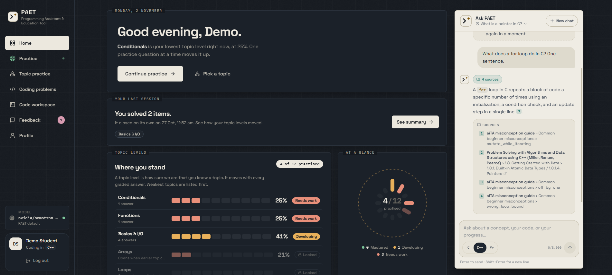
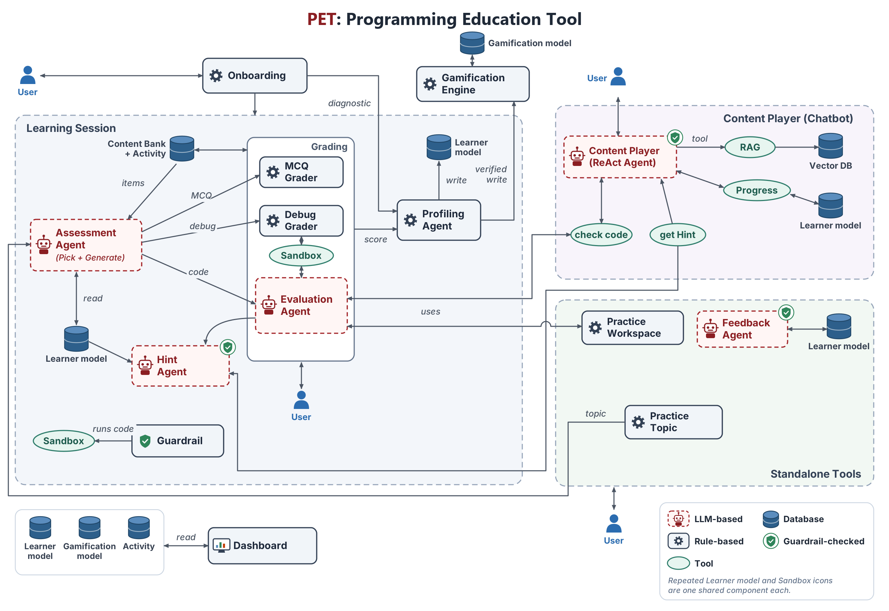

<div align="center">


# PET

**Programming Education Tool**

Learn to code by thinking, not copying.


There is no hosted version. PET runs on your own computer: clone it, start it, and it is
yours.

</div>

---

## Quick start

Needs [Docker](https://docs.docker.com/get-docker/) and Git.

```bash
git clone https://github.com/ChhabhayaManan/PET.git && cd PET && docker compose up -d --build
```

Open http://localhost:5173 and pick a model: paste your own API key (OpenAI, Anthropic,
Gemini, Groq, OpenRouter or NVIDIA NIM), or run `ollama pull qwen2.5-coder:7b` and choose
**Ollama** for a free model that stays on your computer.

The first build takes a few minutes. Stop PET with `docker compose down`; your progress is
kept.

---

## Demo

[](https://youtu.be/VIDEO_ID)

Click the image to watch the demo.

---

## What PET is

PET is a practice platform for students learning to program in C, C++ or Python. It covers
12 topics, from basics and loops to recursion and dynamic programming. Students answer
questions, fix broken code and write programs. PET grades each answer, tracks how well the
student knows every topic, and picks what to practise next. When a student is stuck, it gives
hints one step at a time instead of the answer. A tutor chat answers questions from real
textbooks.

## Why PET

- **Copying is not learning.** A general chatbot hands a beginner the fixed program. The
  student moves on without understanding the bug.
- **Hints, not answers.** PET's help gets more specific only when the student keeps
  failing, and it is checked so it never contains the fix.
- **Grades come from running the code.** A program passes when it passes real tests, not
  when an AI thinks it looks right.
- **Practice follows the student.** Each student gets the next item from their own weakest
  topic, in their own language.

---

## How a student learns with PET

1. **Start.** The student picks an AI model, then a short diagnostic sets a starting level
   for each topic.
2. **Next item.** PET picks a multiple-choice question, a debugging task or a coding
   problem from the weakest topic that is open.
3. **Answer.** Code runs against tests in a sandbox. Multiple-choice answers are checked
   against a key.
4. **Level update.** The topic level moves with every graded answer.
5. **Hints.** After a failed attempt, the student can ask for a hint. Each new hint is a
   step more specific.
6. **Feedback.** At the end of a session, a short report says what went well and what to
   work on next.



---

## What makes it accurate and personal

- **Verified grading.** Code is compiled and run in an isolated sandbox against test cases.
  Generated tests are first checked against a reference solution. A run that cannot be
  verified does not count towards the student's level.
- **Transparent topic levels.** Each answer moves the level by a fixed rule:
  `new = old + 0.3 × weight × (score − old)`. Coding counts most (1.0), debugging 0.8,
  multiple choice and theory 0.5. Hints reduce the score (one hint ×0.9, up to ×0.5 at the
  fourth). Every level can be recomputed by hand from the student's answers.
- **Levels per language.** Knowing loops in Python says nothing about loops in C. Each
  language has its own levels, and switching language starts a short re-check.
- **A four-step hint ladder.** L1 shows the failing input, L2 names the idea, L3 gives the
  steps, L4 points at the line. A guardrail runs any code inside a hint against the tests and
  blocks the hint if it would solve the problem.
- **Cited answers in chat.** The tutor answers from open textbooks and PET's own guides,
  and shows the sources it used.
- **Rewards for real progress only.** Points and badges come from verified results, never
  from time spent or clicks.

---

## Agents

| Agent | Type | What it does | Guardrail |
|---|---|---|---|
| Assessment | Rule-based, LLM on demand | Picks the next item from the weakest open topic; writes a new coding problem when the bank has none | |
| Evaluation | LLM + sandbox | Runs the student's code against verified tests, scores it and explains the result | |
| Profiling | Rule-based | Updates topic levels, points and the learner profile after every graded answer | |
| Hint | Rule-based + LLM | Gives the next step of the hint ladder | Yes |
| Feedback | LLM | Writes the end-of-session report from the student's real answers | Yes |
| Content Player | LLM (ReAct) | The tutor chat: answers questions, searches the books, checks code, gives hints | Yes |

<details>
<summary><b>Assessment agent</b></summary>

Reads the student's topic levels, chooses the weakest topic that is open, and picks an item at
the right difficulty from the content bank. A topic opens once the topics it builds on
reach 40%. If no saved coding problem fits, the LLM writes one, and it is
only served once its tests are verified.

</details>

<details>
<summary><b>Evaluation agent</b></summary>

1. Reads the problem and the student's code.
2. Makes sure the problem has tests that a reference solution passes.
3. Runs the code in the sandbox against every test.
4. Asks the LLM to explain what went wrong, in words, without code.
5. Scores the run and attaches the first hint.

Only verified runs change the student's level.

</details>

<details>
<summary><b>Profiling agent</b></summary>

Records each graded answer, updates the topic level with the rule above, awards points and
badges for verified progress, and refreshes the learner profile that the other agents read.
It uses no LLM, so every number it produces can be checked.

</details>

<details>
<summary><b>Hint agent</b></summary>

Four levels, each unlocked by another failed attempt:

| Level | Shows |
|---|---|
| L1 | The input the program failed on |
| L2 | The idea or concept involved |
| L3 | The steps to get there |
| L4 | The line to look at |

L1 is built from the test result. L2 to L4 come from the LLM and pass the guardrail first: code
in the hint is run against the tests, quoted solution lines are blocked, and a judge checks
that the hint does not state the fix.

</details>

<details>
<summary><b>Feedback agent</b></summary>

Gathers the session's answers, finds patterns in the mistakes, and asks the LLM for a short
report. The report is checked before it is saved so it does not leak a solution.

</details>

<details>
<summary><b>Content Player (tutor chat)</b></summary>

A ReAct agent with four tools: search the course books, read the student's own learning data,
run the student's code, and give a hint. It never writes full programs for the student, and a
moderation check keeps the conversation on learning.

</details>

<details>
<summary><b>Onboarding</b></summary>

New students go through a short setup: a few questions about themselves and their
language, then an adaptive check of up to 12 items (predict the output, fill the blank, find
the bug, write a short program, and a few theory questions). The results set the starting
level on all 12 topics, and practice begins from the weakest open topic.

</details>

---

## Choose your model

PET asks for a model the first time it opens. You can change it later from the **Model**
card in the sidebar. Bring your own key from a cloud provider, or run a free model on your
own computer.

**Cloud**


**Local (runs on your computer, nothing leaves it)**


- **Tested before use.** PET checks the connection, tool calling, structured output and
  context window, and only saves a model that passes all four.
- **Your key stays with you.** It is kept encrypted in your browser and never written to
  PET's database.
- **Clear errors.** If a key stops working (rejected, rate limit, out of credit), PET says
  exactly why.

Optional: to give every student the same model from the start, copy `.env.example` to
`backend/.env`, fill in `DEFAULT_LLM_PROVIDER`, `DEFAULT_LLM_MODEL` and
`DEFAULT_LLM_API_KEY`, and run `docker compose up -d` again.

---

## Tech stack

| Part | Technology |
|---|---|
| Frontend | React 18, Vite, Tailwind CSS, CodeMirror |
| Backend | FastAPI, SQLAlchemy 2, Alembic |
| Agents | LangGraph, LangChain |
| Models | Any OpenAI-compatible provider through one gateway |
| Search | PostgreSQL with pgvector, sentence-transformers |
| Sandbox | Separate container, no network, read-only, limited CPU, memory and processes |

---

## Project structure

```
backend/
  app/core/        config, database, LLM gateway and model choice
  app/features/    one folder per feature: accounts, onboarding, practice, problems,
                   grading, hints, learner_model, feedback, chat, gamification,
                   model_settings
  content/         questions, problems and lessons as JSON, one folder per topic
  executor/        the code sandbox
  scripts/         content loading and evaluation scripts
frontend/src/
  pages/           one file per screen
  components/      interface pieces per feature
docs/figures/      diagrams
```

---

## Safety and privacy

- Student code runs in a separate container with no network access, a read-only file
  system, and limits on time, memory and processes.
- The tutor chat has a moderation check and never writes full solutions.
- Your model key is never written to PET's database.
- PET has no login, so it only accepts connections from the computer it runs on.
- Each AI call is logged with its purpose, provider, model and timing for quality checks.
  Keys and student code are not part of that log.
